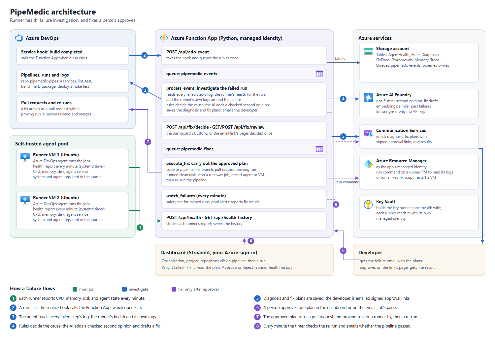

# PipeMedic

An Azure DevOps **agent pool health monitor and pipeline failure investigator** that can fix what it finds, once a person approves.

Azure DevOps tells you that a pipeline failed. It does not tell you whether the code is broken or the self-hosted runner was sick.
PipeMedic reads the failed run's logs, finds the runner that ran it, and joins them with that runner's CPU, memory and disk readings
and its own system logs from the same minutes. It says what failed, why, whether the runner was to blame, and what to do, by email
within about a minute and on a dashboard. It also prepares fixes: a pull request with the change, or an action on the runner. Each
one is carried out only after a person approves it.



## How it works

1. Each runner VM reports its CPU, memory, disk and agent state every minute to an Azure Function, which stores it in Table Storage.
   The watcher emails once when the pool has a problem (an agent offline, a stuck queue, a disk heading for full) and again when it clears.
2. When a run fails, an Azure DevOps service hook calls the Function with the run's id. The Function queues it and investigates at once.
   A one-minute timer catches anything the hook missed.
3. The agent reads every failed step's log, the runner's health for the run's own time window, and the runner's system, kernel and
   agent logs from those minutes.
4. Rules decide the verdict: **code or configuration**, **the runner**, **both**, or **a flaky test**. A model in Azure AI Foundry adds a
   labelled second opinion; every quote it gives must appear in the real logs. The model also drafts a fix where one applies.
5. The diagnosis and the fix plans are saved, and the person who triggered the run gets an email with the cause, the evidence, and a
   signed link to each plan.
6. A person approves one plan, in the dashboard's **Fix it** section or on the page behind the email link.
7. The approved plan runs from a queue: a pull request and a proving run on its branch (lint, tests and build, never a deploy), or a
   runner action, then a re-run. Code reaches the environment only when a person merges the pull request and `main` deploys.
8. Every minute the timer checks the re-run and emails whether the pipeline passed.

## Fix with approval

| Failure | Plan offered | After approval |
|---|---|---|
| Failing test, lint error, bad dependency pin, missing file, code error | A pull request with the AI's change, shown as a diff | Pull request into the failed run's branch and a proving run that tests and builds it without deploying. Never merged automatically; it deploys when merged. |
| The cause is in a pipeline file (for example a step memory limit) | A pull request changing that file, marked as a pipeline change | As above |
| Disk full | Clean old job folders, caches and temp files | Clean-up on the VM, then a re-run |
| A runaway job using the CPU or memory | Stop that named job | Stopped, then a re-run |
| Agent service down | Restart the agent | Restart, wait until it is online, re-run |
| Runner still unhealthy | Restart the VM (last resort) | Restart through Azure, wait for the agent, re-run |
| Flaky test, network, permissions | Re-run | Re-run |
| The AI is unsure, or its change breaks a rule | A job for a person, with the reason | Nothing automatic |

Details: [docs/fix-with-approval-plan.md](docs/fix-with-approval-plan.md). What was built, fixed and checked live:
[docs/WORK_SUMMARY.md](docs/WORK_SUMMARY.md).

## What is in this repository

| Path | What it is |
|---|---|
| `agent/` | The investigator, pool monitor, fix plans and their execution, email, AI second opinion, and the dashboard (`streamlit run dashboard.py`) |
| `health-api/` | The Azure Function App: runner health, the service hook, the investigation queue, the approval endpoints and the fix queue |
| `runner-health/` | The health report every runner runs each minute, its systemd units, and the script that turns a fresh VM into a runner |
| `infra/` | Scripts that create everything in a new Azure subscription and Azure DevOps organization |
| `scripts/` | Creating the Azure DevOps service hooks |
| `benchmark/` | How accurately the rules name the cause, measured on 137 real pipeline failures |
| `docs/` | The architecture diagram, the fix-with-approval design, and the work summary |
| `pipemedic-pipes/` | Four small services and realistic pipelines (lint, test, benchmark, package, deploy, smoke test) with ten failure scenarios to demonstrate PipeMedic on |
| `weather-app/` | A container test bed: a small weather service built with Docker on the runners, pushed to Azure Container Registry and deployed to Azure Container Apps, with nine failure scenarios (its own repository in Azure DevOps; `infra/4_weather_app.sh` creates its Azure side) |

`pipemedic-pipes/` goes into its own Azure DevOps project and repository, and its pipelines run on the same runners; `SETUP.md`
does this. Its `demo/*` branches, each holding one real defect, are listed in [pipemedic-pipes/README.md](pipemedic-pipes/README.md).

## Set it up

See **[SETUP.md](SETUP.md)**: four steps (Azure resources, deploy, Azure DevOps, runners), each with a dry run first.

## Try it

Run a pipeline in `pipemedic-pipes` with a `scenario` (for example `disk-full`), or on a `demo/*` branch (for example
`demo/test-failure`). Within about a minute an email explains the failure and offers fix plans. Then open the dashboard:

```bash
cd agent
pip install -r requirements.txt
streamlit run dashboard.py        # pick organization, project and repository; click a pipeline, then the failed run
```

Under **Fix it**, open a plan to see exactly what it will do, then approve it. A pull request and a proving run, or the runner fix and
a re-run, follow, and an email reports the result.

## Running a demo

`main` in each demo repository is always green and deployable. The defects live on `demo/*` branches, one real committed bug each,
so a failure can be shown again and again without breaking `main`. A pipeline that shows a green tick is only showing its latest run,
usually on `main`; its runs on the `demo/*` branches are the failed ones. Nothing is fixed until someone approves a plan.

**Quick (main stays clean).** Run the pipeline on a demo branch: Pipelines → `weather-app` → Run pipeline → Branch `demo/test-failure`,
scenario `none`. It fails at "Unit tests"; within about a minute PipeMedic emails the cause, and in the dashboard (choose the
`weather-app` repository, click the pipeline, then the run) the **Fix it** section shows the plan. Approve it: PipeMedic opens a pull
request into the demo branch and proves it with a run on the fix branch. Abandon that pull request afterwards so the branch keeps its bug.

**The full story (changes main).** Open a pull request from `demo/test-failure` into `main` and complete it, as a developer merging a bug
would. The `main` pipeline fails at "Unit tests", so nothing is built or deployed and the live app keeps its last good version.
PipeMedic offers a fix for `main`; approve it, then review and complete its pull request, and `main` is green again. Use a bug that
fails in the tests (`demo/test-failure`) for this, not one that fails at deploy.

Runner problems need no branch: run the pipeline on `main` with a scenario (`docker-disk-full`, `docker-daemon-down`; for
`pipemedic-pipes`, `disk-full`, `cpu-starvation` and others). Each one cleans up after itself.

## How it stays safe

- **Rules decide, AI explains.** The verdict comes from rules. The model's opinion is labelled, and its quotes must appear in the logs.
- **Nothing is fixed without a person.** Every fix plan needs one explicit approval and expires after 24 hours. Opening an email link
  only shows the plan; the decision is a button press on that page. A plan is decided once, even if two people press at the same time.
- **Unreviewed code is never deployed.** The proving run on a fix branch tests and builds the change with deployment switched off;
  only `main` (and the `demo/*` branches, which exist to show deploy failures) deploy.
- **The model never runs anything.** It only writes changes, and those go into a pull request that a person reviews and merges.
  Runner actions come from a fixed set of scripts, and only stop jobs run by the agent user, never the agent, ssh, system services or
  deployed apps.
- **No keys in code.** The Function App, the runners and the dashboard sign in with managed identities or your `az login`. The key runners
  post health with is in Key Vault; the key that signs approval links is an app setting of the Function App.
- **Secrets are removed from logs** before anything is sent to the model.

## Tests

```bash
cd agent && python -m pytest tests          # 317 tests
python benchmark/compare.py                 # classifier accuracy on the collected failures
```
